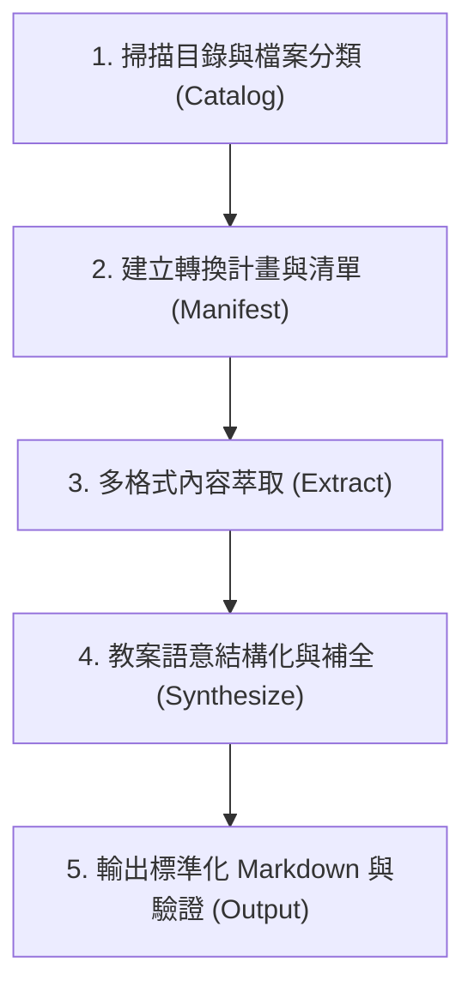

# 教案多格式批次結構化轉換 (Lesson Prep Converter)

本技能指導 AI 如何將使用者指定目錄中的多種零散教學素材（圖片/掃描檔、PDF、Word、PPT、Excel、CSV、TXT），批次轉換為**結構化、附帶 YAML 元數據的標準 Markdown 教案**，使其成為後續產出 PPT、Word 講義、靜態網站的單一真相來源 (Single Source of Truth)。

---

## 核心流程總覽 (Conversion Pipeline)

---

## 步驟一：掃描目錄與建立清單 (Catalog & Inventory)

1. **取得目標路徑**：
   - 檢查使用者指定的目錄（若未指定，詢問目標目錄路徑）。
   - 預設輸出目錄為 `<目標目錄>/_lesson_knowledge_base/`，避免污染原始檔案。
2. **列舉與分類**：
   - **文字/表格**：`.txt`, `.md`, `.csv`, `.tsv`, `.xlsx`, `.xls`
   - **辦公文檔**：`.docx`, `.doc`, `.pptx`, `.ppt`
   - **PDF 文件**：`.pdf`（區分文字版與掃描版）
   - **視覺圖檔**：`.jpg`, `.jpeg`, `.png`, `.webp`, `.bmp`
3. **向使用者回報盤點結果**：
   - 列出發現的檔案數量、檔案類型分佈與預計產出的教案單元清單。

---

## 步驟二：多格式內容萃取策略 (Multi-Format Extraction)

詳細格式技術細節請參閱 [extraction_guide.md](references/extraction_guide.md)。

- **純文字 & CSV / TXT**：
  - 直接讀取內容，解析編碼，若為 CSV 題庫或單元表，轉換為表格或單元問答條目。
- **Word (.docx) & 簡報 (.pptx)**：
  - 萃取正文大綱、條列清單、表格、投影片備忘稿 (Speaker Notes)。
  - 提取文件中內嵌之圖片至輸出目錄的 `images/`，並記錄檔案對應名稱。
- **PDF (.pdf)**：
  - 優先讀取文字層與章節目錄。
  - 若為純掃描版 PDF，按頁面轉為影像後進入視覺解析流程。
- **掃描圖檔與教材照片 (.png / .jpg)**：
  - 利用多模態視覺讀取能力辨識。
  - **重要準則**：注意書本雙欄排版、閱讀順序。過濾書緣陰影、手寫雜記、無關廣告；保留核心教學圖表存入 `images/` 並建立引用標籤。

---

## 步驟三：教案結構化與語意補全 (Structured Synthesis)

所有萃取出的內容，必須統一轉換為符合 [lesson_schema.md](references/lesson_schema.md) 規範的 Markdown 文件。

### 必須遵守之語意原則：
1. **補足教案完整性 (Enrichment)**：
   - 原始素材常只有「題目」或「簡報片段條列」。
   - AI 必須依專業教學法補齊：**具體教學目標 (Bloom's Taxonomy)**、**引起動機提問**、**時間節奏分配 (分鐘標註)**、**評量練習**。
2. **標題階層一致性**：
   - `#`：單元總標題（一檔一主題）。
   - `##`：教學四大階段（引起動機、核心概念、課堂練習、總結評量）。
   - `###`：個別知識點或觀念說明。
3. **YAML 前置元數據 (Frontmatter)**：
   - 包含 `title`, `subject`, `grade`, `duration_minutes`, `learning_objectives`, `tags`, `source_files`, `assets`。

---

## 步驟四：成果輸出與交付 (Delivery & Manifest)

在目標輸出目錄 `_lesson_knowledge_base/` 中建立：

1. **`index.md` (或 `SUMMARY.md`)**：
   - 整體課程地圖 (Curriculum Map) 與所有教案單元連結索引。
2. **`[單元編號]_[主題名稱].md`**：
   - 各單元之標準結構化教案。
3. **`images/`**：
   - 本次轉換所收納、標註之所有教學示意圖與圖表。
4. **`conversion_log.md`**：
   - 記錄每個原始檔案轉入哪個單元、是否有遺漏或難以辨識的頁面警示。

---

## 步驟五：引導下游輸出 (Downstream Guidance)

完成轉換後，主動告知使用者後續如何利用這批結構化檔案：
- **需要 PPT**：可直接使用 Marp 或指示 AI：「請將 `01_單元.md` 轉成 10 頁簡報大綱/Marp 簡報」。
- **需要 Word (講義/考卷)**：可下 Pandoc 指令套用機構 Word 範本輸出 `.docx`。
- **需要 網頁**：直接作為 VitePress / Docusaurus 內容來源，即刻部署線上教案資料庫。
